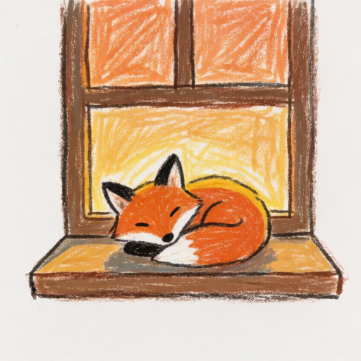
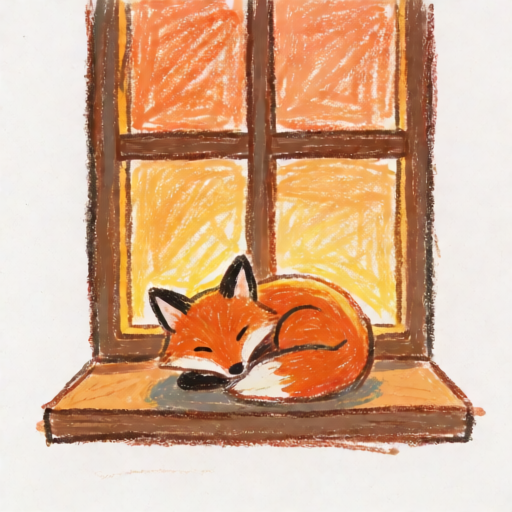
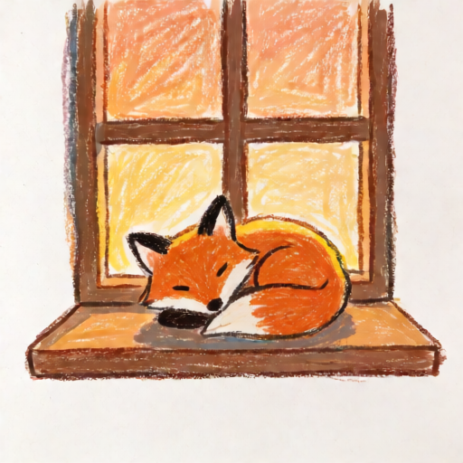

# 人设笔触对照图

- 内容：一只在窗台上打盹的小狐狸
- 提示词：a small fox curled up asleep on a wooden windowsill at dusk, warm orange light, only the fox and the window, simple background

## 纯 Krea2

- LoRA：无
- 说明：不叠任何 LoRA，看模型自身的手绘倾向

```text
画好了：一只在窗台上打盹的小狐狸
1 张 · 蜡笔涂鸦 · 512×512 · 398 KB（26.4 秒）
画法：本地 ComfyUI（人设笔触）；用途：桌宠主动画。
人设笔触：人设笔触（Krea2）。
存进画夹：
- d-20261103T231656-24b586 · unrated/d-20261103T231656-24b586.png（未评价）
图在回执附件里。要拿给对方看，紧接着调用 pet_say，把每条 log: 句柄填进 images；不要在正文里贴句柄。
对方明确说喜欢/不喜欢时，再用 pet_draw_rate 记评价；没评价的留在 unrated。
今天：1/500 张。
```



## Krea2 + masterpieces 0.35

- LoRA：krea2-masterpieces-v51.safetensors:0.35
- 说明：只加画质 LoRA，压低动漫/写实倾向

```text
画好了：一只在窗台上打盹的小狐狸
1 张 · 蜡笔涂鸦 · 512×512 · 392 KB（32.5 秒）
画法：本地 ComfyUI（人设笔触）；用途：桌宠主动画。
人设 LoRA：krea2-masterpieces-v51.safetensors@0.35；人设笔触：人设笔触（Krea2）。
存进画夹：
- d-20261103T231728-e97a2a · unrated/d-20261103T231728-e97a2a.png（未评价）
图在回执附件里。要拿给对方看，紧接着调用 pet_say，把每条 log: 句柄填进 images；不要在正文里贴句柄。
对方明确说喜欢/不喜欢时，再用 pet_draw_rate 记评价；没评价的留在 unrated。
今天：2/500 张。
```



## Krea2 + kazutake 0.4

- LoRA：kazutake-hazano_k2_v1.safetensors:0.4
- 说明：画师风 LoRA，观察是否还能保住蜡笔感

```text
画好了：一只在窗台上打盹的小狐狸
1 张 · 蜡笔涂鸦 · 512×512 · 381 KB（34.5 秒）
画法：本地 ComfyUI（人设笔触）；用途：桌宠主动画。
人设 LoRA：kazutake-hazano_k2_v1.safetensors@0.4；人设笔触：人设笔触（Krea2）。
存进画夹：
- d-20261103T231803-3e9fb7 · unrated/d-20261103T231803-3e9fb7.png（未评价）
图在回执附件里。要拿给对方看，紧接着调用 pet_say，把每条 log: 句柄填进 images；不要在正文里贴句柄。
对方明确说喜欢/不喜欢时，再用 pet_draw_rate 记评价；没评价的留在 unrated。
今天：3/500 张。
```



