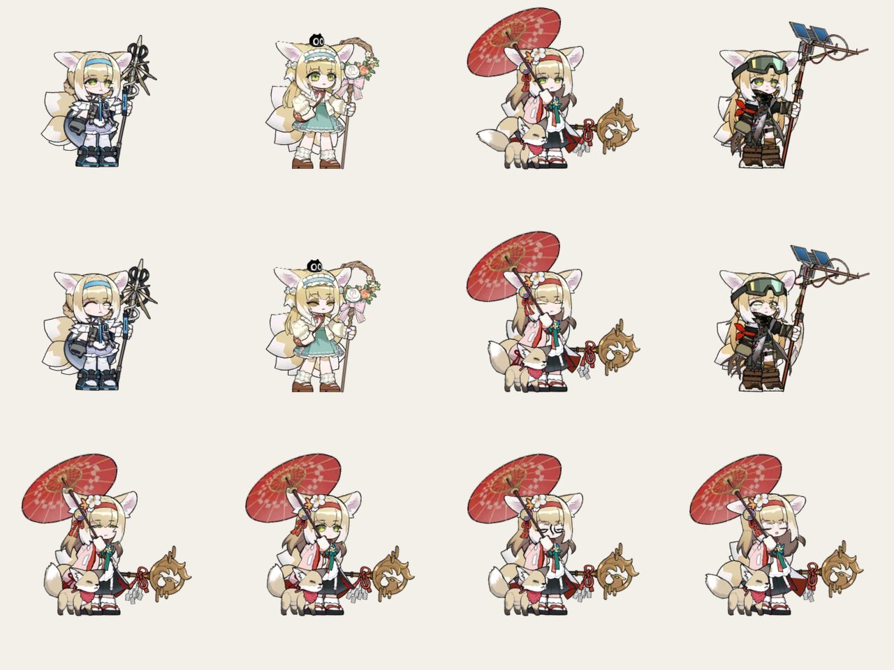

# 铃兰（Suzuran）桌宠形象 · v2

明日方舟干员铃兰的 Coopanion 形象包，**figure api 2 / manifest 2**。



*上排：默认、春之颂、雪霁、弃土花开。下排（雪霁）：眨眼、说话、晕（螺旋眼）、难过。*

和上一版（v1，把所有动作逐帧烤成一张张精灵图）不同，这一版把游戏里的 **Spine 战斗模型**直接搬了进来：
四套服装各一套骨骼，呼吸、头发、尾巴、伞面、狐狸都是原始骨骼动画，逐帧求值后用本包自己的
WebGL 渲染器画出来。所以动作是连续的、不是几张循环图，模型精度也回到游戏原画的水平。

| | v1（旧） | v2（本包） |
| --- | --- | --- |
| 服装 | 3 张立绘 + 烘好的动作图 | 4 套游戏骨骼：默认 / 春之颂 / 雪霁 / 弃土花开 |
| 动画 | 循环 8~16 帧的位图 | 每套 9 个原版动作，逐帧求值（Idle 2.7~9.3 秒） |
| 表情 | 只换开眼/闭眼两张图 | 眨眼、抛媚眼、说话张嘴、晕（螺旋眼）、耳朵尾巴随神情动 |
| 分辨率 | 1024² 大图切片，屏幕上偏糊 | 512² 图集 + 2 倍超采样画布，任意缩放不糊 |
| 体积 | ~5.5 MB | ~3.2 MB |

## 装法

1. 把整个 `suzuran-figure/` 目录放进宿主的形象包目录（`figure.json` 在目录根即可，宿主会往下找三层）。
2. 或者在设置里选「安装形象包」，指向 `suzuran-figure.zip`。

选好之后在**皮肤**里换装：默认（白蓝制服）、春之颂（罗小黑联动的绿裙）、雪霁（红色和服）、弃土花开（护目镜野营装）。

## 会做什么

- **套件自带**的 19 个表情、18 个动作全部可用（开心、害羞、坐下、跳舞……），由套件的身体驱动，
  本包负责把它们画出来：眼睛会眨、会眯、会睁大，嘴会张，耳朵会竖会垂，尾巴会摇。
- **游戏原版动作**（v1 没有的）：`attack` 挥伞、`cast` 施法（技能二）、`twirl` 转伞（技能三整套）、
  `flop` 累倒（倒地动作）。这些是模型里真实存在的整套战斗动画，不是拼出来的。
- 被拎起来、跳、跑、走、坐、睡时，腿和手臂跟着套件给的落点动。
- 晕的时候换螺旋眼（默认和雪霁两套自带）。

## 目录

| 文件 | 作用 |
| --- | --- |
| `figure.json` | 清单：名字、四套皮肤、41 个词、语音音高、特效外扩 |
| `figure.js` | 入口，导出 `createSuzuranBody`（figure api 2） |
| `gl.js` | WebGL 渲染器：预乘 alpha、按槽位合批、上下文丢失后重传 |
| `atlas.js` | Spine 3.8 文本图集解析 + AttachmentLoader |
| `spine38.js` | Spine 3.8 运行时（esbuild 打成单文件，见 NOTICE.md） |
| `model.json` | 生成物：每套服装的缩放/原点/包围盒/锚点/角色骨骼/脸部槽位 |
| `model-data.js` | 生成物：`model.json` 的内嵌版（fetch 不可用时兜底） |
| `skins/<id>/` | 每套服装的 `.skel`、`.atlas`、`.png`，外加老主机用的 `.skel.js`/`.atlas.js` 兜底 |
| `thumbs/` | 包图标与四套皮肤的缩略图 |
| `tools/` | `build-model.mjs` 生成 `model.json`；`check.mjs` 自检 |

## 坐标与画布

逻辑空间是套件规定的 256 单位方格（脚底 y=256）。但铃兰的伞尖会伸到框外（雪霁到 y=-20，弃土花开向右到 x=313），
所以画布比方格大：`VIEW = {x:-104, y:-136, w:512, h:512}`，后备像素 1024²（2 的幂，WebGL1 也能 mipmap）。
`foreignObject` 覆盖同一块范围，`pointer-events: none`，不会挡住点击。

每套服装的 `scale`（每骨骼单位多少逻辑单位）和 `origin`（骨骼原点落在逻辑空间的哪里）由 `tools/build-model.mjs`
按「Idle 第一帧、去掉伞和狐狸后的身体包围盒」算出：四套服装站在一起一样高，脚底落在 y≈250。

一帧只上传极少量的顶点：相邻且透明度相同的槽位合成一次 `drawArrays`，通常**整套衣服只要 1 次绘制**
（雪霁 114 个槽位、1245 个三角形）。

## 自检

```sh
node tools/check.mjs      # 全绿 = 主机能读、插件不会因为缺图白屏
node tools/build-model.mjs   # 改了 skins/ 之后重新生成 model.json 与兜底模块
```

`check.mjs` 做的事：

- 按 `src/packs.ts` 的规则检查 `figure.json`（id/轴/预设/vocab/名字不能重复也不能带空格或标点、
  目录内路径不能有 `..`、音效类型、`moves`/`needs`/`voice`/`effects` 范围……）；
- `import` 一次入口模块，确认导出的工厂在；
- 打开每套服装的骨骼与图集，确认**每一个附件都在图集里**（包括动画里中途换上的附件），
  角色骨骼、肢体骨骼、脸部槽位都真实存在，动作齐全；
- 确认 `.skel.js` / `.atlas.js` 兜底模块和原文件逐字节一致；
- 统计体积与文件清单。

## 兼容性

- 清单是用主机自己的 `readManifest`（`src/packs.ts`）验证过的：`api 2`、`manifest 2`、41 个词全部读入，
  没有跳过项。
- 身体用主机 `web/kit/body.js` 的 `createBody` 造，`step/layout/do/walk/sit/sleep/dizzy/dispose` 都跑通过
  （在 Node 里用假 DOM 跑的真实套件）。
- 渲染走 WebGL2，失败时退 WebGL1；画布尺寸是 2 的幂，两种都能 mipmap。上下文丢失会重传贴图。
- **老版本宿主**（0.2.13 及更早不放行 `fetch`）：自动改用 `skins/<id>/*.skel.js`（gzip+base64）和
  `*.atlas.js` 兜底；解压需要 `DecompressionStream`（Chromium 80+），再老就没有兜底了。
- 包里没有 `video`/`audio`/字体元素，沙箱里不会因为这些东西加载失败；音效留空（`sounds: {}`）。

## 已知边界

- 表情是**程序化**的：眨眼是真的压扁眼部件、说话是真的放大嘴部件，但模型的脸部美术只有「眼睛/嘴/睫毛」
  这几类部件，没有腮红、汗滴、泪珠的独立贴图，所以害羞/哭这类表情靠姿势（低头、耳朵下垂、发抖）表达。
- 战斗模型没有走路循环，也**没有能看见的腿**：腿上的小图（`F_L/R_Leg`、`Calf`、`Foot`）被长袍的蒙皮网格完全盖住（把腿骨强转 40° 截图对比，屏幕上一点变化都没有）。所以走/跑是用身体演的：上下颠、落地压扁、左右换重心、头比身子慢半拍，再叠套件给的手臂摆动。旧版模型能迈腿，是因为它把腿单独烘成了图片。
  看上去是"迈小步"，不是游戏里的走路动画。
- 站姿动画（Idle）各套服装长度不同：默认 2.7 秒、春之颂 9.3 秒、雪霁 8.4 秒、弃土花开 2.7 秒。
- 春之颂（`lxh_1`）自带原生眨眼（`F_L/R_Eyeclose` 换图），所以那一套不做程序化眨眼，避免眨两次。

## 素材来源与许可

角色与模型数据 © Hypergryph / Yostar（明日方舟），取自游戏客户端、经
[fexli/ArknightsResource](https://github.com/fexli/ArknightsResource) 公开的 Spine 资源。
Spine 运行时遵循 Esoteric Software 的 Spine Runtimes License。详见 [NOTICE.md](NOTICE.md)。
本包的代码（`figure.js`/`gl.js`/`atlas.js`/`tools/`）以 MIT 提供。
